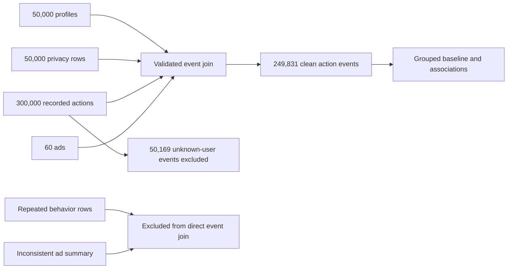

# Privacy Preferences and Recorded Advertising Actions

## A secondary-data feasibility study for the Personalization Threshold project

**Project 49C — second-review draft, 6 November 2026**  
Risaal K P, Upamanyu M, Harisankar S  
Goa Institute of Management, Big Data Analytics

**Release note:** The later `0.1.0` implementation adds an evidence-gated, consent-constrained threshold decision contract. It returns `insufficient_evidence` on these data. See `UPGRADE_V0_1_0.md`; no consumer-level threshold result is added to this manuscript.

**Later secondary-data finding:** This draft evaluates the original 49-C ad/event tables. A separate 837-person unsolicited-social-ad survey was subsequently found in `try these dataset/` with six direct, general intrusiveness items. Its independent respondent-level analysis is in `SECONDARY_SURVEY_PHASE_V1.md`. The survey has no linked ad creatives or five observed personalization levels and was not merged with the original tables; missing-label statements below refer to the original 49-C tables.

## Abstract

The original 49C proposal sought to estimate the highest ad-personalization level appropriate for each consumer. This study evaluates whether the supplied secondary data can support that claim and tests a narrower observable outcome. We cleaned five core CSV tables and found 50,000 unique profiles, 50,000 unique privacy records, 60 ads, and 300,000 recorded action events. Exactly 249,831 events join to a known user and ad; 50,169 have unknown user IDs. The 50,000 behavior rows represent only 31,600 unique users, so a direct join would multiply action events. The separate ad-level summary does not reconcile with the event table: none of its per-ad action counts match, and four ads report more clicks than impressions. We therefore model only the event table, with the target defined as click versus another *recorded action*. On a user-grouped holdout, logistic regression using ad and privacy codes achieved ROC-AUC 0.4993 and Brier score 0.18824, versus 0.5000 and 0.18820 for a constant baseline. The secondary data contain no ad-personalization level or perceived-intrusiveness outcome. These files do not support an empirical personalization threshold, click-through model, or intrusion prediction.

**Keywords:** personalized advertising; secondary data; privacy preferences; data quality; recorded actions; predictive validity

## 1. Introduction

The proposed Personalization Threshold asks how much a marketer should personalize an ad before its privacy cost outweighs any engagement benefit. The concept requires two measured relationships: response to different personalization levels and perceived intrusiveness at those levels. This revision uses only the secondary files supplied with the project and tests what can be established without new data collection.

Three research questions guide the work. **RQ1:** Which source records can be joined without multiplying or losing observations? **RQ2:** Are available privacy and ad codes meaningfully associated with the type of recorded action? **RQ3:** Can those codes predict whether a recorded action is a click better than a constant baseline? These are feasibility and association questions; they do not assume that an action measures comfort or that the files contain experimental variation in personalization.

The word *intrusive* also describes a separate problem in web advertising. Yan et al.'s **Adhere** detects and proposes repairs for ads that disrupt a webpage or violate Better Ads Standards using DOM parsing and mutation observers [6]. Its unit is a rendered ad on a website and its outcome is standards compliance. Project 49C screens personal-data references and high-pressure tactics in the ad content supplied by a marketer. The original research question concerns consumers' perceived privacy intrusion; the pressure-tactic component is a later prototype extension prompted by an aggressive image-ad failure case. Adhere is relevant as an example of inspectable detection and real-world evaluation, but it is not an intrusiveness-label source for this classifier. We use the term **ad-content intrusiveness risk** for the expanded screening output.

| Comparison | Adhere [6] | Project 49C |
| --- | --- | --- |
| Intrusion being assessed | Disruption of page viewing under Better Ads Standards | Content risk from personal-data references and pressure tactics |
| Input and unit | Rendered desktop/mobile website, DOM, and changes during loading | One marketer-supplied ad as text or OCR-readable image, plus optional targeting details |
| Detection | Rules for pop-ups, autoplay sound, sticky ads, density, and related formats | Explicit cue-weight rubric for privacy cues, countdowns, scarcity, extreme discounts, urgent commands, and alarmist claims |
| Output | Standards violations and suggested page or ad-container repairs | Low/moderate/high tier, 0–10 cue score, matched evidence, and editing suggestions |
| Evidence of validity | Manually checked website sample with confusion matrices against a competing audit | Sanity checks only; no consumer-rated intrusion labels in the supplied secondary files |

The transferable design is **detect, explain, suggest a repair, and recheck**. Adhere's fixes change attributes or ad containers to address page obstruction; our suggestions address the specific privacy or pressure cue in the message. Neither its Better Ads labels nor its reported detection metrics transfer to ad-content intrusiveness. A future evaluation of 49C should use an independent, human-labelled secondary ad set and publish a three-class confusion matrix, per-class precision/recall, text-versus-image coverage, and error cases. The current six fictional survey conditions are not that benchmark.

## 2. Data preparation and analytic unit

The CSV exports have a table name on line one and actual field names on line two. We parse the second line as the header, standardize whitespace in field names, validate primary and foreign keys, and preserve original event IDs. The cleaned core tables have no blank fields, but they have major structural and semantic limitations.

| Source | Rows | Distinct relevant ID | Data-quality finding |
| --- | ---: | ---: | --- |
| User profiles | 50,000 | 50,000 users | Unique user key |
| Privacy features | 50,000 | 50,000 users | Unique user key |
| User behavior | 50,000 | 31,600 users | 13,183 users have multiple rows |
| Ad characteristics | 60 | 60 ads | Age and country criteria do not match available user fields |
| User interaction events | 300,000 | 300,000 event IDs | 50,169 events have no matching profile |
| Valid event–user–ad–privacy join | 249,831 | 249,831 event IDs | Main analytic table |

All event ad IDs match known ads. The valid event table contains 49,690 distinct users. We exclude unmatched-user events from user-linked modeling and save them with an explicit `unknown_user` reason. We do **not** deduplicate 11,909 repeated user–ad pairs: without timestamps or exposure identifiers, two rows may represent distinct actions. We also do not join the behavior table directly, since its repeated user IDs would duplicate events. The main analytic unit is a **recorded user–ad action event**, not an ad impression or a unique consumer exposure.

The coding table identifies interaction codes 32, 33, 34, and 35 as like, share, comment, and click. Data-sharing permissions have numeric codes 2–6 and labels level1–level5, but their direction is not documented. “Privacy settings” codes 20–31 label departments such as Sales and Engineering, not degrees of privacy protection. Consent is coded yes/no. These variables are treated as nominal categories; we do not assign a privacy-sensitivity score. The behavior data consist largely of URL-like strings and device model names in a field called `Purchase_History`, so we do not treat them as verified shopping interests or purchases. The five Excel files are identical copies of one 1,125-row questionnaire workbook with coded item names and no supplied item wording or join key; we do not infer an intrusiveness label from them.

## 3. Reconciliation of the ad-level summary

The separate `interaction.csv` table has 60 ad-level rows with action totals and impressions. For every ad, its likes, shares, comments, and clicks differ from counts of the corresponding action codes in the 300,000-row event table. None of the 60 ads has a matching total. Four summary rows report clicks greater than impressions, and 31 report total actions greater than impressions. Multiple action types could make total actions exceed impressions, but clicks exceeding impressions and the complete non-reconciliation rule out treating this table as the denominator for individual event outcomes. We keep it in the audit and exclude it from the predictive join. The one-ad, 1,000-user `intercation_Per_AD_Table.csv` has no clear exposure definition or link to an individual non-action outcome, so it is also excluded.

## 4. Methods

We calculate conditional click fractions for each ad, permission, privacy-setting, and consent code and summarize action-type association with Cramér's V. This effect-size measure is more useful than a significance test alone with a large dataset, where very small differences may still be statistically detectable. These are descriptive associations among *recorded actions*.

For prediction, the target is 1 for click code 35 and 0 for like, share, or comment codes 32–34. The predictors are ad ID, permission code, privacy-setting code, and consent code, each encoded categorically. We compare an intercept-only constant probability with L2-regularized logistic regression. We assign unique users to a seeded 80/20 train/test split, so no user's events occur on both sides. We report ROC-AUC, Brier score, log loss, and cutoff-based accuracy, precision, and recall. No ad-level aggregate outcome or event ID enters the model.

## 5. Results

The original event table contains 74,782 likes, 74,978 shares, 75,086 comments, and 75,154 clicks. After the valid join, the training set contains 199,891 events from 39,752 users and the untouched test set contains 49,940 events from 9,938 other users. The test click fraction is 0.2514.

| User-grouped test metric | Constant baseline | Logistic regression |
| --- | ---: | ---: |
| ROC-AUC | 0.5000 | 0.4993 |
| Brier score | 0.18820 | 0.18824 |
| Log loss | 0.56387 | 0.56398 |
| Accuracy at 0.5 cutoff | 0.7486 | 0.7486 |
| Click recall at 0.5 cutoff | 0 | 0 |

The model does not improve on the constant baseline. Accuracy reflects predicting every recorded event as a non-click at the 0.5 cutoff, rather than useful click identification. The association magnitudes are also small: Cramér's V is 0.0029 for permission code, 0.0064 for privacy-setting code, 0.0038 for consent, and 0.0146 for ad ID. These results do not establish causal effects of privacy settings, and they do not imply that consumers with a given code tolerate more personalization.

## 6. Three-tier ad screening prototype

To provide a marketer-facing text or image input despite the absent intrusion labels, we implemented `intrusive_ad_model.py` as a transparent **rule-based proxy classifier**. Tesseract.js OCR extracts English words printed in an image. The classifier now has two separately reported cue totals. Privacy cues include approximate location, observed browsing, purchase history, precise location, sensitive personal facts, direct identifiers, explicit surveillance, and targeting settings. Pressure cues include countdowns, scarcity, extreme discounts, urgent commands, alarmist claims, and repeated exclamation marks. Multiple personal-data sources and specific activity details can raise the privacy total. The two totals are added and capped at 10 for display; scores 0–1 map to low, 2–5 to moderate, and 6–10 to high. This is not a probability. The local browser interface, `marketer_app.py`, accepts pasted copy or an image and displays the tier, score, both cue totals, matched evidence, and cue-linked editing suggestions. These are proposals for review, not experimentally tested improvements in consumer perception. An image with no readable text requires a supplied visual description or manual review; the prototype does not recognize visual objects or page layout.

The supplied aggressive Instagram-style image is a useful failure case: the earlier privacy-only rubric returned low, 0/10 despite readable OCR of a countdown, a 99% discount, limited stock, urgent instructions, and alarmist text. The expanded rubric returns high, 10/10 (0 privacy points and 12 pressure points before the display cap). This checks expected behavior on one constructed image; it does not establish consumer agreement or three-class accuracy.

An external diagnostic exposed the screen's lack of broad coverage. We used a fixed seed to sample 30 high and 30 low opinion-concern images from the University of Washington Ad Perceptions Dataset [7], where concern means the maximum participant share assigning *clickbait*, *deceptive*, or *manipulative*. Before abstention, 29 of 30 high-concern images and all 30 low-concern images received low rubric scores. The upgraded screen returns `needs_review` for those 59 zero-cue images, while one high-concern image remains high. This is a safer uncertainty response, **not** improved discrimination. These opinion labels do not measure perceived personalization intrusion and cannot validate the 49C tiers. The sample and outputs are reproducible with `external_screen_audit.py` and the preserved result files.

This algorithm is a screening rubric, not a supervised model of consumer ratings. We considered a three-cluster method, but the 60 source ads have no rated intrusion classes and occupy a narrow range of generic copy. Forcing three clusters would label some ads “high” solely because the algorithm must partition them. Applying the rubric to all 60 ad rows assigns all 60 to the low tier; this reports cue coverage in the dataset, **not classification accuracy**. The six fictional ad conditions in the attached draft survey were used as sanity checks: A 0, B 2, C 3, D 3, E 9, and F 10 out of 10. Those are model scores for constructed examples, not participant responses or validation observations. The tier should be called an estimated content risk, not perceived intrusiveness.

## 7. Discussion and conclusion

The original threshold requires observed personalization intensity and an intrusiveness outcome. Neither exists in the supplied secondary files. An engagement action cannot substitute for perceived comfort; users may click an ad they find intrusive. The ad-level summary cannot repair the missing exposure denominator because it conflicts with the event table. Thus, a five-level individual threshold, expected engagement lift from increased personalization, and intrusiveness-risk optimization are **not estimable** from these files. The model we can fit has chance-level ranking performance for the narrower click-versus-other-action target.

This project now has a defensible secondary-data contribution: a reproducible join audit, a cleaned event dataset, a source reconciliation, a negative predictive baseline, and an explainable three-tier screening prototype. The prototype helps a marketer flag personal-data cues and high-pressure wording in new ad copy or readable image text, but its categories are not validated consumer reactions. These records should not drive individualized personalization or privacy-risk decisions. A future secondary dataset could support the original threshold question only if it contains ad-level personalization treatment or a credible intensity measure, per-exposure outcomes including non-actions, and directly observed or validated intrusiveness responses linked at the consumer level. Such data are not present in this folder.

## 8. Reproducibility and repository

Run `python analysis.py` in the source folder using Python with `numpy` and `pandas`. The script reads original files without changing them and writes `results/clean_events.csv`, `results/excluded_events.csv`, `results/audit.json`, `results/associations.json`, and `results/baseline.json`. The split uses random seed 49. Run `python screen_dataset.py` for the supplied-ad tier table and `python -m unittest test_model.py` for the three-tier rule checks. `MODEL_README.md` gives text and image commands and OCR dependencies. `PROJECT_STATUS.md` maps the review feedback to completed work. No public repository URL was supplied; the team should add the real URL if it publishes one. The current local folder is `C:\Users\imhar\Desktop\amlbt`.

## 9. AI use declaration

An AI assistant assisted with source inspection, cleaning and analysis code, the rule-based ad screening prototype, interpretation of the first-review feedback, and drafting this revised manuscript. The named authors must verify the counts, model implementation, wording, citations, and submission compliance. No primary survey, intrusiveness label, or threshold result was fabricated.

## References

1. De Keyzer, F., Dens, N., and De Pelsmacker, P. (2022). “How and when personalized advertising leads to brand attitude, click, and WOM intention.” *Journal of Advertising*, 51(1), 39–56. DOI: 10.1080/00913367.2021.1888339.
2. *User Behavior & Advertisement Analytics Dataset*, Version 5-2-2025 Encoded, Zenodo (2025). DOI: 10.5281/zenodo.15716809. Dataset description supplied as `README.pdf`.
3. White, T. B., Zahay, D. L., Thorbjørnsen, H., and Shavitt, S. (2008). “Getting too personal: Reactance to highly personalized email solicitations.” *Marketing Letters*, 19(1), 39–50.
4. Tucker, C. E. (2014). “Social networks, personalized advertising, and privacy controls.” *Journal of Marketing Research*, 51(5), 546–562.
5. Li, C. (2016). “When does web-based personalization really work? The distinction between actual personalization and perceived personalization.” *Computers in Human Behavior*, 54, 25–33.
6. Yan, Y., Zheng, Y., Liu, X., Medvidovic, N., and Wang, W. (2023). “Adhere: Automated Detection and Repair of Intrusive Ads.” *2023 IEEE/ACM 45th International Conference on Software Engineering (ICSE).* DOI: [10.1109/ICSE48619.2023.00051](https://doi.org/10.1109/ICSE48619.2023.00051). This work addresses webpage disruption and standards violations, not perceived privacy intrusion.
7. Zeng, E., Kohno, T., and Roesner, F. (2021). “What Makes a ‘Bad’ Ad? User Perceptions of Problematic Online Advertising.” *CHI 2021.* DOI: [10.1145/3411764.3445459](https://doi.org/10.1145/3411764.3445459). [Dataset](https://github.com/eric-zeng/chi-bad-ads-data).
