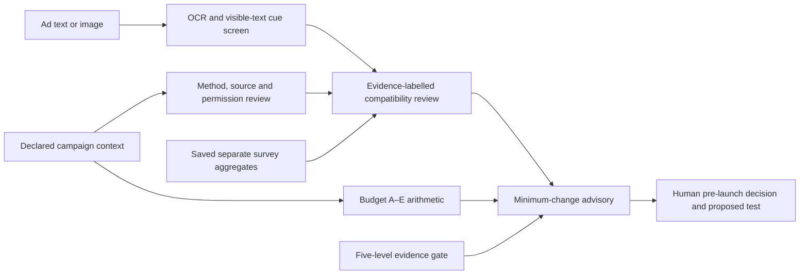

# Phase 8 — hybrid STP architecture and privacy boundary

**49-C | 8 November 2026.** The system has two conceptual modes. **Mode A is implemented and remains the default.** Mode B has an executable **offline schema validator**, but no upload endpoint, customer analysis or live targeting capability. This distinction is intentional: secondary survey respondents are not the marketer's audience.

## 1. Mode A: research-informed pre-launch advisor

The marketer submits ad copy or an image, and may declare product category, channel, objective, targeting method, data source, permission/eligibility, budget, committed spend, change costs and performance context. The local server runs OCR for printed English text, the existing creative cue rubric, the unchanged five-level evidence gate, deterministic Phase 7 budget comparison and the Phase 8 compatibility review. It shows source-separated saved survey aggregates. No customer database is needed. No survey or Criteo model runs against an upload.

**Evidence contract:** (1) an uploaded creative and its extracted text are observable, but OCR/regex coverage is incomplete; (2) method, channel, source, permission and costs are *marketer declarations*; (3) Gen Z and Romano–Han profiles describe unrelated samples; (4) financial scenarios are user-entered counterfactual assumptions. Only **direct response on this ad, treatment and eligible audience** could justify compatibility or uplift predictions. The `/api/analyze` response keeps the existing creative and `strategy` fields, adding `compatibility` only for campaign requests. It never returns a consumer record, customer identity or numeric compatibility score.

The method/source review recognizes generic, contextual, broad demographic, behavioural, historical, combined and sensitive methods; data-source choices include none, page context, broad demographic, first-party browsing/purchase, third-party, combined and other. A declared personal method with an unknown source, a known source/method conflict, unresolved permission/eligibility, third-party/other use or sensitive targeting leads to `hold_for_review`. This is a workflow stop, **not** a legal determination. Category and channel guide the next measurement question but do not change the creative rubric or imply fit.

The economic comparison preserves:

| Option | Incremental implementation cost | Recommendation status |
|---|---|---|
| A — keep current campaign | 0 | Default comparator when no review blocker exists. |
| B — revise one creative | Entered revision cost | Editorial hypothesis when pressure/privacy cues warrant review and known budget permits. |
| C — adjust eligible targeting in the same campaign | Targeting change + management | Displayed only; no automatic lift claim. |
| D — test one additional variant | Variant + management + segmentation | Displayed only; no automatic rollout. |
| E — multiple segment variants | Count × variant + management + segmentation | Displayed only; reach/fragmentation and evidence warning. |

Headroom is total budget minus committed spend; an option is affordable only with complete entered costs and known headroom. Break-even extra conversions are `ceil(extra cost / entered contribution margin)` when the margin is positive. User-entered worst/central/best scenarios are sensitivity arithmetic, not model estimates. C–E cannot be automatically endorsed by the separate survey profiles. The threshold engine remains `insufficient_evidence`.

## 2. Optional Mode B: contract before customer analysis

`phase8_audience_contract.validate_rows()` validates an **in-memory** list and returns only counts. It is not wired to an HTTP route or browser control and does not store files. The unit is an event, not a survey respondent. This is a schema/security feasibility component, **not** a demonstration on real public customer records, a recommendation engine or a prediction model.

| Field | Type and rule | Required? | Meaning and limitation |
|---|---|---|---|
| `anonymous_customer_id` | 16–64 lowercase hexadecimal characters | Yes | Pseudonymous event linkage within one authorized source. The validator cannot prove that an ID was generated safely or that the person is anonymous. |
| `event_timestamp` | ISO 8601 with timezone; no future value | Yes | Event time for ordering/recency if later validated; conversion to UTC for duplicate checks. |
| `event_type` | `product_view`, `cart`, `purchase`, `ad_impression`, `ad_click` | Yes | Explicit event semantics; counts do not themselves establish causal effect. |
| `behavioral_targeting_permitted` | Literal boolean `true` for **every** row | Yes | Declared permission gate. False, missing or string values stop the batch. Separate verification of source, purpose and opt-out state is still required. |
| `product_category` | Short controlled lowercase code, e.g. `running_shoes` | Product events | Necessary for any future category-affinity analysis; do not infer a category from UPAD's opaque browsing strings. |
| `campaign_id`, `ad_id` | Short opaque code | Ad impression/click events | Campaign and creative context; repeated exposures require trustworthy IDs and timestamps. |

Unknown columns are rejected; in particular names, email, phone, precise location, IP address, device advertising IDs, sensitive demographics, raw free text, implicit `clicked` or `converted` flags and survey-attitude joins are not accepted. The validator rejects malformed/naive/future timestamps, unsupported event types, missing category on product events, missing campaign/ad codes on ad events and indistinguishable duplicate event tuples. A real source with multiple identical events at the same instant would need a safe event ID and an approved contract revision; no arbitrary deduplication is applied. It accepts at most 100,000 rows in memory. Success returns event-type counts, row count and distinct pseudonym count, with no IDs or individual profile. **No actual Mode B audience records were loaded in Phase 8.** Small synthetic rows in unit tests verify software behaviour only and are not model observations.

The current validator has no file retention because it has **no file input/output**. If a later Mode B pilot is authorized, define source-specific permission checks, access control, encrypted/local storage or ephemeral processing, retention/deletion periods, opt-out propagation, minimum aggregate cell size, incident handling and audit logging before accepting records. Pseudonymization does not make data anonymous. A flag in a CSV is not proof of lawful consent. Audience exclusion and eligibility must not be inferred from survey privacy concern or sensitive demographics. Any processing must stop on missing or revoked permission, unknown source provenance, unexpected columns, cross-source identity ambiguity or inadequate denominators.

## 3. Why existing secondary files were not used as a Mode B demonstration

UPAD's `UserBehaviorTable.csv` has 50,000 rows but only 31,600 distinct user IDs, repeated rows, no timestamps and undocumented browsing/purchase strings. Its action table contains **recorded actions**, no valid non-action impression denominator, and source referential inconsistencies. Criteo's anonymous features and binary treatment do not encode interpretable product categories or the marketer's consented customer events. The UCI online-shopping sessions are sessions rather than stable customer histories with permission and product-affinity meaning. Gen Z/Romano survey responses have no identity bridge to these files. These sources cannot safely validate the proposed category-affinity, recency and frequency logic for a marketer's real audience. No synthetic identities or artificial cross-dataset join were introduced.

## 4. Future promotion gates

1. **Source and rights:** explicit permitted reuse; minimized data; purpose/consent and opt-out provenance; no unnecessary identifiers.
2. **Measurement:** respondent and creative IDs, randomized or well-identified targeting treatment, direct relevance and intrusion responses, click/conversion and impression denominators on the same unit.
3. **Validation:** training-only preprocessing, respondent/ad-disjoint holdout, relevant baseline, uncertainty, high-intrusion false reassurance and subgroup checks, then independent transfer.
4. **Business:** measure lift and incremental contribution under the same budget; preserve reach and eligibility. Only then consider C–E as active recommendations.
5. **Five levels:** test all five defined treatments with appropriate observations and eligibility. Until then the full threshold remains `insufficient_evidence`, even if a narrower location-specific effect is measured.

No automatic publishing, campaign platform integration, unrestricted audience upload or individual targeting is present in Phase 8.
